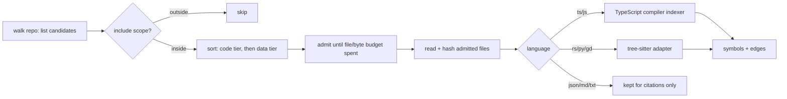

# Design: Multi-language index

## Outcome
- Owner problem and desired observable change: importing a large, mostly non-TypeScript repo
  (`~/code/voidhorizon`: Rust, GDScript, Python, some TS) yields a usable map. Today it yields 0 symbols:
  the importer only accepts TS/JS/JSON/Markdown/text, and its 5,000-file cap is spent alphabetically on
  `art-gen/` and `docs/` JSON before any code is reached. Separately, the VS Code extension needs a
  separately started backend and a pasted login URL; the owner wants it to run standalone.
- Constraints and failure consequences: indexing must still never execute or install anything from the
  studied repo (initial-plan constraint 4). Runs (sandbox + instrumentation) stay JS-only in this change.
  One PR covers import budget, new languages and the standalone extension (owner decision D1, D2).
- Outcome evidence: unknown until observed. Intended check: re-import voidhorizon and see non-zero
  symbols and call edges for Rust, Python, GDScript and TS files, with code files kept ahead of data files.
- Architectural contribution: collaborative (no queue mode supplied); the model proposes technical design,
  the owner decides product scope and consequential tradeoffs.

## Preservation obligations
- Data, behavior or interfaces that must survive replacement: API v1 is frozen (`docs/mind-meld-studio/api.md`);
  existing TS symbol ids (`<file>#<qualifiedName>`) must not change, because recorded runs and citations
  reference them; TS instrumentation (`packages/core/src/instrument.ts`) shares `symbols.ts` with the indexer.
- Authoritative executable contracts: `packages/core/src/schema.ts` (`CodeSymbol`, `StaticEdge`, `Language`),
  core and server test suites, `fixtures/combat-game`.
- Reproduction entry point: `POST /api/projects {kind:'local', ref:'~/code/voidhorizon'}` →
  5,000 files (3,503 JSON), 11,175 skipped by file limit, 0 symbols (observed 2026-11-13).

## Assumptions
| Consequential assumption | Disconfirming probe | Evidence / unknown | Revision if wrong |
|---|---|---|---|
| The existing `CodeSymbol`/`StaticEdge` shape fits Rust, Python and GDScript without breaking API v1 | Map each language's functions/methods/types onto `SymbolKind` | unknown | Add optional fields only; never change existing ones |
| The web UI does not branch on language | `grep language packages/web/src` | verified: no matches | — |

## Canonical Vocabulary
| Term | Definition |
|------|-----------|
| Import budget | The file-count and byte limits on one import (`DEFAULT_LIMITS` in `import.ts`). |
| Code file | A file whose language has a symbol indexer. Data files (JSON, Markdown, text) are kept for citations and Q&A but never indexed for symbols. |
| Language adapter | The per-language unit that turns one code file into symbols and call sites. |
| Standalone extension | The VS Code extension starting the Studio backend inside the extension host, as the desktop app does, with no separately started server or pasted login URL. |

## Decisions
### D1: One PR for import budget and new languages
**Decision:** Import-budget prioritization and Rust/Python/GDScript indexing ship together.
**Rationale:** Owner direction ("one PR for both").
**Alternatives considered:** Two PRs (smaller import fix first); declined by the owner.

### D2: Standalone VS Code extension is in the same PR
**Decision:** The extension runs the backend in-process, like `packages/desktop/src/main.ts`.
**Rationale:** Owner direction (asked "Same PR" when offered a separate PR).
**Alternatives considered:** Separate follow-up PR; keep extension as client-only.

### D3: Tree-sitter WASM for new languages; grammars vendored
**Decision:** Rust, Python and GDScript are parsed with `web-tree-sitter` (WASM). The three grammar `.wasm`
files are vendored in `packages/core/grammars/` with a manifest recording each grammar's npm package, version,
license and sha256; a checked-in TypeScript script regenerates them (Rust/Python copied from their npm
packages, GDScript built from `tree-sitter-gdscript` source with the pinned tree-sitter CLI).
**Rationale:** Owner choice. WASM runs unchanged in Node, Electron and the VS Code extension host with no
native builds. The grammar npm packages run native install scripts, so the runtime never installs them.
Spike (2026-11-13): web-tree-sitter 0.27.2 loaded all three (ABI 14/15) and parsed voidhorizon files with no
errors in 1–8 ms.
**Alternatives considered:** native `tree-sitter` bindings (Electron/.vsix packaging cost); a hand-written
GDScript parser (weaker, own maintenance).

### D4: TypeScript/JavaScript keep the TypeScript compiler
**Decision:** TS/JS indexing and instrumentation are unchanged; the new languages are added as language
adapters beside it, behind one dispatch by file extension.
**Rationale:** Preserves existing symbol ids and the shared indexer/instrumenter walk that runs depend on.
**Alternatives considered:** Move TS to tree-sitter too (would risk symbol-id drift and break recorded runs).

### D5: New languages map onto existing symbol kinds
**Decision:** No new `SymbolKind` values. Rust `fn` → function; functions in `impl`/`trait` → method
(`Type.name`); `struct`/`enum`/`trait` → class. Python `def` → function; `def` inside `class` → method
(`Class.name`); `class` → class. GDScript top-level `func` → function; `func` inside `class X:` → method
(`X.name`); inner `class` → class. `exported`: Rust `pub`; Python and GDScript names not starting with `_`.
`async`: Rust `async fn`, Python `async def`; GDScript false. Nested functions are not symbols (as in TS).
**Rationale:** API v1 is frozen and the web UI renders by kind; additive mapping keeps every client working.
**Alternatives considered:** New kinds (`struct`, `trait`, `module`) — clearer but changes the API surface.

### D6: Call-edge resolution for new languages reuses existing resolutions
**Decision:** `local` (callee defined in the same file), `this-member` (`self.x()` to a method of the
enclosing type), `import` (Python `from m import f` / `import m` resolved to a repo file), `name-match`
(any other call whose name matches symbols elsewhere). A name-match fans out to at most a small fixed number
of targets; a common name above that bound produces no edge.
**Rationale:** Same evidence vocabulary as TS; the UI already shows name-match as the weakest kind. Without a
bound, names like `new`, `get` or `_ready` would connect everything.
**Alternatives considered:** Rust `use`-path and GDScript `preload`/`class_name` resolution — deferred.

### D7: Import budget keeps code first and the caps grow
**Decision:** The import walks once to list candidate files (path, size, language), then admits them in
priority order (code files, then data files; path order within a tier) until the budget is spent, and only
then reads the admitted files. Defaults rise to 20,000 files and 150 MB total; per-file 1 MB stays.
**Rationale:** voidhorizon's code alone is ~6,800 files / ~52 MB, above both old caps, and alphabetical
admission spent the budget on `art-gen/` JSON. *Owner away when decided — assumption, revisit if the caps
are wrong for your machines.*
**Alternatives considered:** Separate budgets per tier; keep old caps and rely on scoping.

### D8: Optional import scope
**Decision:** A project may carry an `include` list of repo-relative directories; when present, only files
under them are imported, now and on refresh. Set through an optional `include` field on
`POST /api/projects` and a repeatable `--include` CLI flag; stored on the project (new nullable column).
UI surfaces stay unchanged in this PR.
**Rationale:** Lets a large repo be narrowed (e.g. skip `art-gen/experiments`). An optional request field is
additive, so API v1 clients are unaffected. *Owner away when decided — assumption.*
**Alternatives considered:** A scope file inside the studied repo (repo content is untrusted input).

### D9: Standalone VS Code extension embeds the backend
**Decision:** By default the extension starts the Studio backend in its extension host (127.0.0.1, random
port, fresh token, data in the extension's global storage) and connects to it, as the desktop app does.
A setting switches to an external backend, keeping today's Connect flow. The .vsix bundles the backend, the
web UI and the grammar files.
**Rationale:** Owner direction (D2). In a WSL window the extension host runs on Linux, so workspace paths
are readable by the embedded backend.
**Alternatives considered:** Spawning a separate `node` backend process (needs a Node on the user's PATH).

## Visualizations

### Import and index flow

## Edge Cases & Scenarios
- Scenario: repo with more data files than the budget → expected behavior: code files are kept first.
- Scenario: code alone exceeds the budget → code files admitted in path order until full; the rest reported
  as skipped with reason `file limit reached`.
- Scenario: a file fails to parse (syntax error) → tree-sitter still yields a partial tree; symbols found
  are kept, nothing throws.
- Scenario: `include` names a directory that does not exist → import yields zero files (no error), so the
  user sees an empty map and the skipped list explains nothing was in scope.
- Scenario: `include` contains `..` or an absolute path → rejected with a validation error.
- Scenario: a Python method calls `self.helper()` where `helper` is in a base class in another file →
  name-match edge (bounded), not this-member.
- Scenario: the user allowlists an exported Rust/Python/GDScript function → rejected with a validation
  error naming the language. Today's allowlist check (`packages/core/src/studio.ts:146`) only tests
  `exported` and kind, so this PR adds a language check; runs stay JS/TS-only.

## Q&A Summary
**Q:** Should the standalone extension go in this PR? **A:** Same PR.
**Q:** How to parse Rust/Python/GDScript? **A:** Tree-sitter WASM, GDScript grammar vendored.
